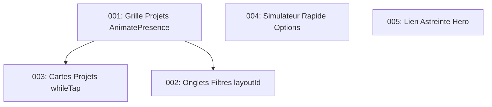

# Plans d'Amélioration des Animations — BEGEC BTP

Feuille de route des améliorations cinétiques et micro-interactions pour la page d'accueil ([Home.tsx](file:///home/hamidou/Documents/site-begec-btp_2/client/src/pages/Home.tsx)), basées sur la philosophie de retenue d'Emil Kowalski et le Design System technique de BEGEC BTP.

---

## Liste des plans

| N° | Titre | Sévérité | Catégorie | Fichiers cibles | Statut |
|---|---|---|---|---|---|
| [001](001-project-grid-filter-transitions.md) | **Transition de disposition fluide & AnimatePresence sur le filtrage des projets** | `HIGH` | Missed opportunities & Teleporting state | `client/src/pages/Home.tsx` | `TODO` |
| [002](002-category-filter-tabs-pill-and-feedback.md) | **Pastille active glissante (`layoutId`) & feedback d'appui sur les onglets de filtres** | `MEDIUM` | Feedback & Spatial consistency | `client/src/pages/Home.tsx` | `TODO` |
| [003](003-project-cards-tap-feedback.md) | **Feedback tactile au toucher (`whileTap`) & protection anti-sticky hover sur les cartes chantiers** | `MEDIUM` | Feedback & Physicality | `client/src/pages/Home.tsx` | `TODO` |
| [004](004-quick-estimator-button-press-feedback.md) | **Feedback d'enfoncement mécanique & transitions ciblées sur le simulateur rapide** | `LOW` | Feedback & Performance | `client/src/pages/Home.tsx` | `TODO` |
| [005](005-hero-astreinte-link-microinteraction.md) | **Translation directionnelle de flèche & feedback d'appui sur le lien d'astreinte Hero** | `LOW` | Feedback & Cohesion | `client/src/pages/Home.tsx` | `TODO` |

---

## Ordre d'exécution recommandé & Dépendances



1. **[001](001-project-grid-filter-transitions.md)** : À exécuter en premier. Établit la structure `motion.div layout` et `AnimatePresence mode="popLayout"` sur la grille de réalisations.
2. **[003](003-project-cards-tap-feedback.md)** : Dépend de 001. Complète les props de la carte de projet avec `whileTap={{ scale: 0.985 }}`.
3. **[002](002-category-filter-tabs-pill-and-feedback.md)** : Complète le système de filtrage en synchronisant la pastille active `layoutId="activeCategoryPill"` avec la grille.
4. **[004](004-quick-estimator-button-press-feedback.md)** : Autonome (Section Simulateur Express). Remplace `transition-all` par des transitions ciblées et ajoute `active:scale-[0.97]`.
5. **[005](005-hero-astreinte-link-microinteraction.md)** : Autonome (Fiche opérationnelle Hero). Harmonise l'icône de flèche avec le reste de l'application.

---

## Comment exécuter un plan

Chaque plan est 100% autonome et contient le code source exact, les valeurs cibles (courbes, durées, replis d'accessibilité) et le protocole de vérification mécanique et ressenti.

Pour lancer l'exécution d'un plan avec un agent dédié :
```bash
# Exemple d'exécution
improve-animations execute plans/001-project-grid-filter-transitions.md
```
